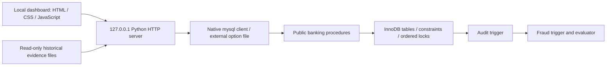
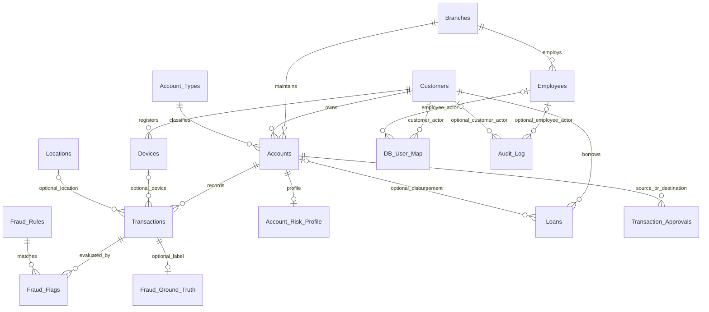
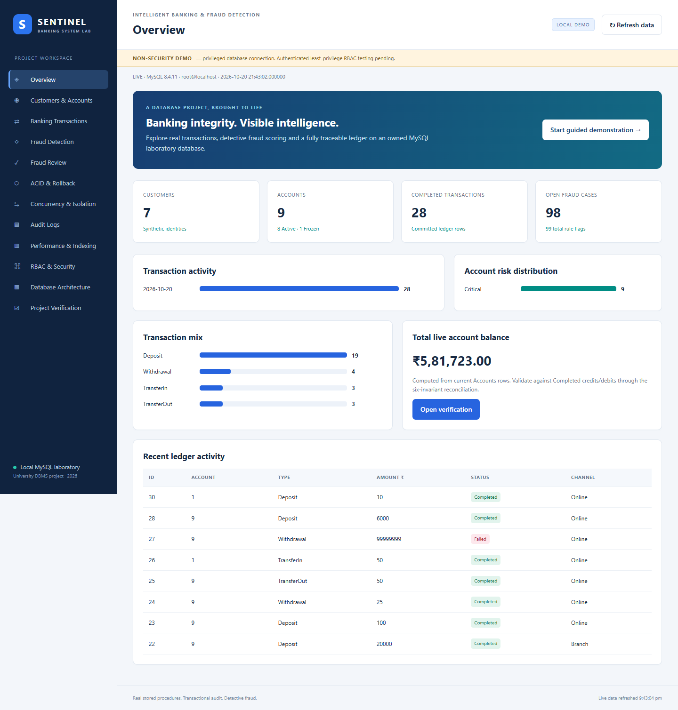
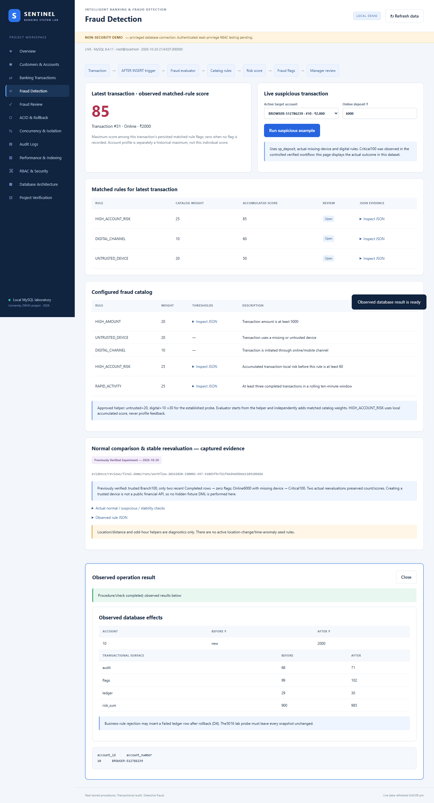
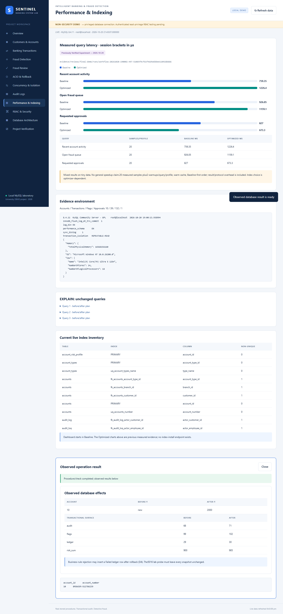
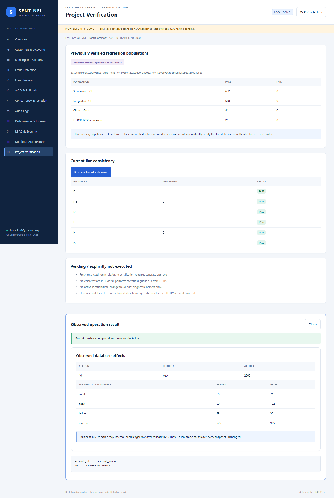

# Intelligent Banking Transaction Processing & Fraud Detection System
## ACID Compliance, Concurrency Control, Audit Logging and Performance Tuning

**University:** [University name]  
**Department:** [Department name]  
**Programme / semester:** [Programme and semester]  
**Submitted by:** [Student names and USNs]  
**Project guide:** [Guide name and designation]  
**Academic year:** [Academic year]  
**Implementation record:** 20 October 2026  
**Repository:** Bank-Transaction-System-ACID-Compliance-Fraud-Detection-Performance-Tuning  
**Verification base:** branch `feature/final-demo`, HEAD `8298f855f2020f01a518eaa53425fa66af629962`, plus uncommitted CLI/dashboard delivery additions.

Personal and institutional fields intentionally remain placeholders for the authors.
All banking identities and identifiers used in demonstrations are synthetic.

## Contents

1. Abstract
2. Introduction
3. Problem statement
4. Objectives
5. Scope
6. Existing versus proposed system
7. System requirements
8. Architecture
9. ER model and relational schema
10. Normalization and constraints
11. Banking transaction implementation
12. ACID compliance
13. Isolation and concurrency control
14. Deadlock detection and retry
15. Fraud scoring mechanism
16. Stored procedures, functions, triggers and views
17. RBAC and audit logging
18. Indexing and query optimization
19. Implementation methodology
20. Dashboard walkthrough
21. Testing methodology
22. Actual test results
23. Performance measurements
24. Screenshots and capture instructions
25. Challenges and resolutions
26. Limitations
27. Future scope
28. Conclusion
29. References
30. Appendix: setup, execution and evidence

## 1. Abstract

This project implements a MySQL8.4 banking transaction laboratory that connects
financial operations with consistency checks, detective fraud evaluation and an
auditable event history. Customers, accounts, deposits, withdrawals, transfers,
loans and approval requests are represented by related InnoDB tables and public
stored procedures. Ordered row locks and explicit transaction handlers protect
multi-account transfers. Completed ledger entries are immutable, while audit and
fraud triggers participate in the same transaction as the banking operation.

A localhost dashboard makes the implementation observable through live forms,
tables, charts and a guided academic demonstration. The application reuses the
native MySQL client and existing procedure contracts rather than duplicating
financial logic in Python. It displays historical isolation/deadlock/performance
evidence separately from live database observations. An owned disposable schema
lifecycle protects established project databases during evaluation.

Previously executed safe SQL populations achieved632 Standalone and688 Integrated
passes with no failures. The dashboard delivery added nine HTTP boundary tests,
a32-check real database HTTP workflow and an actual browser walkthrough. Six
banking invariants passed. These overlapping counts are not combined into a
single inflated total. Fresh restricted-login RBAC certification, crash recovery
and representative large-data performance conclusions remain explicitly outside
the completed demonstration.

## 2. Introduction

A banking operation is more than an update to a balance column. The application
must preserve an interpretable ledger, reject invalid transitions, coordinate
concurrent writers and make the resulting changes attributable. A transfer is a
useful example: debit and credit must form one transaction, concurrent requests
must not lose updates, and audit or fraud side effects must not survive a failed
financial operation independently.

The project treats these requirements as executable database contracts. Its
public routines are the mutation boundary; constraints protect structural rules,
guards protect immutable and minimum-balance behavior, and reconciliation checks
evaluate consistency after realistic workflows. The dashboard allows an evaluator
to inspect these contracts without manually writing SQL. It is an educational
local application, not a production banking service.

## 3. Problem statement

Design and demonstrate an integrated transaction system in which banking,
fraud evaluation, audit and authorization operate together without contradicting
one another. Specifically, prevent partial transfers, maintain balance/ledger
agreement, attribute changes to the authenticated session, detect supported risk
signals and expose verifiable results. A second problem is methodological:
installation and testing must not damage existing databases or confuse old
evidence with newly executed checks.

## 4. Objectives

- Provide public routines for registration, account lifecycle and financial
  operations, with meaningful MySQL errors and explicit transaction ownership.
- Maintain Completed ledger, transfer-pair, balance-chain, minimum-balance and
  audit-watermark invariants.
- Evaluate actual configured fraud rules automatically after ledger insertion.
- Preserve customer ownership and employee branch rules while documenting the
  difference between authorization logic and authenticated least privilege.
- Demonstrate rollback, isolation, ordered locking, real deadlocks and retries
  using bounded owned-database tests.
- Compare unchanged Baseline/Optimized index profiles using measured samples and
  EXPLAIN, without assuming that every index improves every query.
- Deliver a reproducible offline dashboard, evidence and academic explanation.

## 5. Scope

Implemented database scope includes sixteen banking/fraud tables, helper test
objects in a separate schema, banking public/private routines, seven specified
fraud functions, guards, audit/fraud triggers, identity-filtered views, RBAC
installer source and optional performance indexes. Existing loan and approval
workflows remain available through the database and CLI.

The dashboard's live mutation scope is registration, opening, deposit, withdrawal,
transfer, fraud review and the bounded development-mode rollback probe. It also
provides history, statements, audit inspection, metadata and live reconciliation.
Isolation, deadlock and latency charts use labeled verified evidence rather than
running long experiments during HTTP requests.

The model assumes single-owner accounts and one currency. There is no real
payment network, payment gateway, production identity verification, internet
deployment, machine-learning fraud claim or new location/time-anomaly rule.

## 6. Existing versus proposed system

For conceptual comparison, a minimal CRUD teaching application would let its
application code update balances and display success without independently
checking a ledger or concurrent behavior. That conceptual baseline is not an
external product measured in this report.

The proposed implementation puts financial behavior behind database routines,
records Completed and eligible Failed transactions, makes audit and fraud effects
transactional, and provides explicit invariant checks. Its dashboard displays
observed results and native errors instead of optimistic success messages. Test
targets are collision-checked disposable databases, not a shared production-like
schema. This makes failures reproducible and their scope explainable.

## 7. System requirements

| Component | Requirement / measured configuration |
|---|---|
| Database | MySQL8.4 with InnoDB, CHECK constraints, JSON, window functions and stored objects; measured8.4.11 |
| Application | Python3.10+ standard library; measured3.12.14 |
| SQL access | Native mysql executable; external private client option file |
| Windows tools | PowerShell5.1+; executable paths may contain spaces |
| Browser | Modern browser with Fetch, CSS Grid and JavaScript; actual UI tested in installed Microsoft Edge |
| Optional browser QA | Playwright with installed Edge; not an application dependency |
| Network | Loopback127.0.0.1 only; no CDN, cloud service or package download required |
| Hardware evidence | Intel Core Ultra5 125H,14cores/18logical processors,16568156160bytes RAM; Windows NT10.0.26200.0 |

Flask was absent from the available runtime. The permitted standard-library
HTTP-server fallback was used instead of introducing an installation dependency.
This choice is appropriate only for the bounded local evaluation: Python's
http.server documentation cautions against production use [R5].

## 8. Architecture



The browser cannot choose a database, supply SQL, invoke a shell, provision
accounts or drop schemas. The server accepts only fixed operation schemas and
validates inputs using the existing CLI parser. The active session file supplies
the generated database and owner token. Startup verifies the owner marker before
serving requests. State-changing requests require POST, JSON, an exact local
Origin and a CSRF token; the Host header is restricted to the actual loopback
address and port. Static resources are served from a fixed allowlist.

The native client receives UTF-8 SQL through stdin with no shell interpolation.
All financial mutations use public routines. Read-only metadata is obtained from
information_schema. A request lock prevents overlapping dashboard actions and
snapshots from confusing an instructional before/after comparison; genuine
concurrency is established separately by the existing native-session experiments.

## 9. ER model and relational schema

The application queries the installed schema's tables, FKs, routines, views,
triggers and indexes. The following overview matches those real relationships;
nullable edges and detailed column types are defined in schema files and SPEC.



| Relation | Key and important references |
|---|---|
| Branches | branch_id PK; unique synthetic IFSC code |
| Employees | employee_id PK; branch FK; unique email; Teller/Manager/DBA |
| Customers | customer_id PK; unique email, phone and proof; active/KYC attributes |
| Account_Types | account_type_id PK; unique name; rate and minimum balance |
| Accounts | account_id PK; customer/branch/type FKs; unique number; balance/status |
| Transactions | BIGINT transaction_id PK; account/counterparty/employee/device/location references; transfer group; amount/status/reference |
| Loans | loan_id PK; customer FK; optional disbursement account FK |
| Fraud_Flags | flag_id PK; transaction/rule references; score, JSON evidence, review status |
| Audit_Log | BIGINT audit_id PK; JSON old/new values; session and optional actor FKs |
| Devices | device_id PK; customer FK; unique fingerprint; trust flag |
| Locations | location_id PK; geographical descriptive/coordinate columns |
| Fraud_Rules | rule_id PK; unique code; weight, parameters and active flag |
| Account_Risk_Profile | account_id PK/FK; score, level and evaluation/update times |
| DB_User_Map | db_login PK; exactly one Customer or Employee FK according to actor_type |
| Transaction_Approvals | approval_id PK; source/destination account FKs; requester/decision/group linkage |
| Fraud_Ground_Truth | transaction_id PK/FK; synthetic label for evaluation datasets |

Transactions.related_account_id is an optional second Accounts reference.
Approvals have two distinct Accounts references, not a single composite account.
Additional employee references identify transaction staff, reviewers and decision
makers. Audit_Log.table_name/record_pk is a polymorphic audit label, deliberately
not a generic FK. The owner-marker table and helper schemas are test infrastructure,
not business entities. Ground-truth storage does not imply measured classifier
precision/recall; no such accuracy claim is made here.

## 10. Normalization and constraints

Separate Branches, Employees, Customers and Account_Types relations avoid
repeating descriptive data in every transaction. A transaction references an
account instead of duplicating its owner's complete identity. Fraud rule catalog
and flag instances separate policy configuration from observations. Unique
candidate keys prevent duplicate natural identifiers, and FKs maintain referenced
entity existence using RESTRICT actions.

The design is substantially normalized, but intentionally stores derived state:
Accounts.balance supports efficient locked updates, Account_Risk_Profile stores
summary risk and Audit_Log/Fraud_Flags contain historical JSON evidence. Such
choices require reconciliation and clear lifecycle rules rather than an unsupported
claim that every stored attribute is an independent third-normal-form fact.

CHECKs enforce nonnegative balances, positive financial amounts/principal/tenure,
score bounds and consistent audit actor fields. UNIQUE constraints prevent repeated
reference numbers, duplicate transfer leg types within a group, and duplicate
transaction/rule flags. Procedure checks and triggers enforce cross-table minimum
balances and legal transitions that simple row-local constraints cannot express.

## 11. Banking transaction implementation

Registration validates customer attributes and uses synthetic demonstration data.
Opening checks an active customer and valid branch/type, creates the account and
posts a Completed opening Deposit. That opening convention makes the ledger
explain the balance from inception instead of requiring an unexplained initial
balance offset.

Deposit/withdraw routines validate amount/channel/staff and lock the account.
Withdrawal preserves the type's minimum balance. Transfers lock two Accounts
rows in canonical account-ID order, compute balances under those locks and use
relative updates. They write one TransferOut and one TransferIn with the same UUID,
equal amounts and mirrored account/counterparty fields. Device/location metadata
is stored only on the debit transfer leg. Public signatures are unchanged.

Transfers of at least100000 require approval; a request moves no money. A decision
locks the request and requires an appropriate active Manager distinct from the
requester. Approval uses the internal transfer path within the caller's transaction;
rejection closes the request without moving funds. Loan disbursement, when routed,
creates a Deposit rather than silently adjusting the account.

Eligible business rejections5003/5004/5005/5006/5010 can create Failed ledger rows
after rollback in a separate small transaction. This does not mean a partial
Completed transfer. Deadlock/timeout and lab-injected failures are not recorded as
business Failed transactions. The dashboard shows actual before/after counts so
this distinction remains visible.

## 12. ACID compliance

**Atomicity.** Public mutation procedures own transaction control and rollback
handlers. The live dashboard's bounded transfer mode1 actually raises5016 after
debit work. The HTTP test observed identical balances, ledger/audit/flag counts
and aggregate profile risk before and after. Audit and fraud changes participate
in the same rollback; neither is committed independently by a trigger.

**Consistency.** Six executable invariants inspect derived state rather than
assuming that successful SQL means a valid system. They cover balance/ledger
equality, per-account balance_after chains, paired transfers, minimum-balance
rules, audit watermark coverage and the newest Completed balance_after.

**Isolation.** Ordered locking protects concurrent transfers. Existing experiments
also record dirty-read differences at all four supported levels. Snapshot reads
and locking reads are different mechanisms; observed behavior must be tied to the
actual statement and schedule rather than an isolation-level label alone [R1].

**Durability.** Prior measured settings included flush-at-commit1, sync_binlog1 and
binary logging ON, and committed changes remained visible across separate native
connections. This demonstrates committed persistence in normal operation, not
power-loss or crash-recovery certification. The dashboard does not restart MySQL.

## 13. Isolation and concurrency control

The verified two-session dirty-read probe held an uncommitted +7 balance change
for4seconds, then rolled back. The reader started after1second with a1second lock
timeout. READ UNCOMMITTED observed100382.00; READ COMMITTED and REPEATABLE READ
observed the committed100375.00. SERIALIZABLE's read blocked and returned actual
1205. The dashboard reproduces the retained native output as historical evidence,
not an animation claimed to be a new experiment.

Bounded ordered Quick used two actual sessions with five opposite-direction
transfers each. Ten operations produced twenty Completed ledger legs; six
invariants passed afterward. These observations support the specified smoke
workload only, not a universal claim of deadlock freedom for arbitrary database
operations. The server serializes ordinary GUI requests and deliberately provides
no endpoint that launches a stress grid or changes global isolation.

## 14. Deadlock detection and retry

The real comparison created a cycle using EXP10's temporary database-only
mode3 first-lock scheduling pause. One native session received1213 and one
completed. The original routine was restored afterward; ordered mode and shipping
source were unchanged. An earlier uninstrumented run did not deadlock and was
retained as a failed expectation rather than relabeled as success.

The public retry wrapper retried whole transactions after actual1213/1205,
recorded its retry after rollback and used bounded randomized backoff. The
verified pair of retry calls completed and produced a committed DEADLOCK_RETRY
row. Error1205 is a wait-timeout observation, not proof of a cycle; the project's
procedure handler explicitly rolls back its transaction. InnoDB deadlock handling
and application retry should be considered together [R2].

## 15. Fraud scoring mechanism and rules

The engine is deterministic rule-based detective fraud evaluation, not a learned
classifier. The AFTER INSERT fraud trigger calls the evaluator for Completed
transactions. It rebuilds risk from transaction facts and active rule parameters,
writes unique transaction/rule flags with evidence JSON and updates a profile
maximum. It does not block the banking transaction on a risk classification.

Approved helper contributions are untrusted/missing device+20 and digital
channel+10. The established small digital/untrusted helper probe scores30.
Amount≥5000 adds20 in the helper and amount≥10000 adds35. The evaluator supplies
profile input0, preventing a score it has just stored from feeding back into the
same transaction.

| Active catalog rule | Threshold | Added weight |
|---|---|---:|
| HIGH_AMOUNT | amount≥5000 | 20 |
| UNTRUSTED_DEVICE | missing device or trust false | 20 |
| DIGITAL_CHANNEL | Online or Mobile | 10 |
| HIGH_ACCOUNT_RISK | accumulated transaction-local score≥60 at this rule | 25 |
| RAPID_ACTIVITY | at least3 Completed transactions in10minutes | 25 |

The helper base and matched catalog weights are distinct additive stages. Thus
helper30 is not a promise that the final catalog score is30. Scores are capped100;
levels are Low below30, Medium below60, High below85 and Critical otherwise.

In the verified controlled normal scenario, a trusted Branch deposit100 with
only two recent Completed rows produced no flags. In the controlled suspicious
scenario, a missing-device Online deposit6000 reached Critical100 and generated
matched-rule evidence. The new HTTP workflow independently observed the latter
result. The page displays persisted values instead of hardcoding100.

Two actual reevaluations without changed facts preserved flag count and summed
scores in the prior workflow. A profile is a maximum over evaluated events and
must not be confused with the selected transaction's score. Distance and odd-hour
functions exist as diagnostics, but there is no active location-change or time
anomaly rule in the seed. No such automatic detection is claimed.

## 16. Stored procedures, functions, triggers and views

Public banking routines provide validated operations; private sp_internal_*
helpers avoid transaction control so the caller owns atomicity. Functions include
balance/available-balance/interest/reference/masking/approval helpers and the seven
specified fraud functions: distance, z-score, count window, odd hour, account age,
transaction risk score and risk level. Their signatures are checked by existing
regressions.

Six guards protect minimum balances, immutable ledger/audit rows, device ownership
and self-counterparty rejection. Nine audit triggers cover Accounts, Transactions
and Loans INSERT/UPDATE/DELETE; Transactions UPDATE/DELETE auditing is normally
unreachable because guards reject those operations. Fraud is ordered FOLLOWS the
Transactions INSERT audit trigger. The ordering is verified from installed
ACTION_ORDER, not only from source comments. MySQL supports explicit ordering
between same-event/timing triggers [R3].

The views are v_customer_account_summary, v_transaction_activity and
v_fraud_case_queue. The dashboard shows their installed DEFINER metadata. Source
files and build/file_order.txt preserve A/B dependency order: tables, FKs,
functions, procedures, guards/audit/watermark, rules/fraud trigger, seed and views.
RBAC deployment and optional indexes are separate explicit operations.

## 17. RBAC and audit logging

The database role design covers Customer, Teller, Manager and Auditor. Public
procedure EXECUTE grants are explicit; private helpers and wildcard EXECUTE are
not application permissions. Identity resolution follows actual USER() through
DB_User_Map, with documented fallback behavior. Application roles require a
correct mapping; selecting a role label in a GUI would not authenticate anyone.
MySQL roles represent collections of privileges and must actually be granted and
activated for a restricted login [R4].

Customers receive own summary/activity and approved public financial/statement
APIs. Staff activity is active and branch-filtered. Managers have the fraud queue
and manager APIs but no Audit_Log SELECT grant; the customer-summary view does
not become an all-account view merely because a Manager can SELECT it. Auditor
receives read-only approved information, not statement/mutation EXECUTE. Unmapped
auditor activity may be empty under the implemented identity filters.

This delivery uses a prominently labeled privileged administrative walkthrough.
It does not create users, roles or grants. Native RBAC preview and authorization
logic have been tested, but fresh authenticated restricted-login certification
remains pending separate approval.

Audit rows include entity, action, old/new JSON, performed_at, session USER() and
resolved actor. The watermark records when trigger coverage began. Earlier loaded
rows are not falsely treated as missing new audit events. UPDATE/DELETE guards
do not make the log safe from a privileged DBA who can drop triggers or truncate
tables. The report does not describe it as tamper-proof.

## 18. Indexing and query optimization

B0 contains only PK, UNIQUE and FK-required indexes. The Optimized profile
explicitly adds the existing seven performance indexes. Neither page visits nor
dashboard actions silently install them. The live Architecture/Performance pages
show current metadata, whereas latency charts load a separate historical
Baseline/Optimized measurement run.

EXPLAIN is used to identify access paths, ordering and possible index selection.
An index being available does not mean the optimizer should select it for a tiny
table. Query timing and plan changes must be interpreted together rather than
equating an index name with a speed improvement.

## 19. Implementation methodology

The work began by inspecting the integrated branch, prior evidence, public
interfaces and safe lifecycle. Existing financial/fraud/security SQL was retained.
The CLI was used as the reference adapter for argument validation, native process
execution and public routine SQL. A standard-library server and offline frontend
were added, then checked with syntax and HTTP boundary tests before any live
mutation.

Live testing used one freshly generated owned database. Ownership was checked at
startup; operations were made through HTTP and public procedures. Edge browser
tests exercised the actual DOM, forms, navigation and responsive layout. Only
targeted dashboard tests were rerun after UI changes. The large historical SQL
suite was not repeated unnecessarily because production SQL was unchanged.

## 20. Dashboard walkthrough

The interface uses a navy sidebar, light content panels, blue/teal metrics and
twelve coherent sections. Overview statistics, account balances, transaction
mix/activity and profile risk distribution come from actual MySQL rows. The
guided flow presents twelve stages with Previous/Next controls.

An evaluator registers a synthetic customer, opens an account and uses the actual
returned IDs. The selected new customer propagates to opening; the new account
becomes a sensible banking default. Deposit, withdrawal and transfer forms show
native procedure output, before/after balances and ledger/audit/fraud count
effects. Statements and history use the same database and server authorization.

Fraud Detection shows the latest persisted matched-rule score, classification,
catalog thresholds and JSON evidence. Its Online6000 action posts a real public
deposit. The normal trusted-device comparison is explicitly previously verified
evidence, since provisioning a controlled trusted device is not a public banking
operation. Fraud Review filters status/risk and invokes real legal transitions.

ACID provides a bounded live5016 rollback probe and reconciliation. Concurrency
and Performance show labeled captured output; Audit shows live old/new JSON.
RBAC explains the actual source contract and pending authentication test. The
Architecture section is populated from information_schema, and Verification
separates historical regression populations from its live six-invariant button.

## 21. Testing methodology

Testing has three new layers. Nine standard-library HTTP tests verify the shell,
CSRF rejection, foreign Origin/Host rejection, absent arbitrary-SQL/traversal
routes, JSON boundary, allowed POST and refusal of cleaned/protected session
records. These use a fake adapter only for request-boundary unit testing and are
not presented as database proof.

The real HTTP runner uses the running owned dashboard and has no SQL interface of
its own. It registers/opens, executes financial operations, checks balances,
statements, native rejection, suspicious flags and manager review, then verifies
rollback, audit order, all six invariants and evidence/metadata endpoints.

The real Edge test loads the page, traverses all twelve destinations, starts the
guide, registers and opens through browser forms, checks actual-ID propagation,
submits a live deposit, checks invariants, captures screenshots and verifies mobile
overflow and uncaught JavaScript errors. A stored markup-shaped synthetic name is
rendered as literal text, not HTML. Tests do not substitute mock balances for live
banking observations.

## 22. Actual test results

Historical results below are explicitly previous final-demo executions, not new
dashboard reruns. Populations overlap and must not be summed.

| Population | PASS | FAIL | Classification |
|---|---:|---:|---|
| Standalone SQL | 632 | 0 | Previously verified |
| Integrated SQL | 688 | 0 | Previously verified actual A+B runtime |
| CLI workflow | 41 | 0 | Previously verified |
| ERROR1222 seed regression | 25 | 0 | Previously verified |
| Dashboard HTTP safety tests | 9 | 0 | Executed for this delivery |
| Real MySQL HTTP workflow | 32 | 0 | Executed for this delivery |
| Extended browser workflow | 23 | 0 | Executed in installed Edge; actual screenshots |

The HTTP workflow opened20000, deposited100, withdrew25 and transferred50,
observing20025.00. A6000 suspicious deposit produced actual matched flags with
maximum score100. Review advanced an actual flag through UnderReview to Confirmed.
The5016 rollback snapshots were identical. All six reconciliation results were
PASS with0 violations: I1, I1b, I2, I3, I4 and I5. The browser added another public
deposit and subsequent consistency is checked before owned cleanup.

Prior runtime acceptance retained two missing/blocked role checks because no
fresh role grants were deployed. This is not converted into a completed security
certification. No production SQL or approved scoring policy was modified to
obtain these results.

## 23. Performance measurements and limitations

The retained final-demo fixture contained10 Accounts,39 Transactions,132 flags
and1 approval. Each of three fixed SELECTs had2 warmups and20 measured samples
under each profile, for120 measured observations. Native session NOW(6) brackets
excluded process startup but included query/result production and interstatement
client/protocol overhead; they are not isolated CPU timings.

| Query | Baseline mean µs | Optimized mean µs | Plan observation |
|---|---:|---:|---|
| Recent account activity | 759.35 | 1226.40 | FK ref/filesort to account/time range/backward scan |
| Open fraud queue | 926.05 | 1159.10 | Full scan/filesort retained |
| Requested approvals | 827.00 | 673.30 | ALL/filesort to status/requested index access |

These are mixed tiny-data observations, not evidence of a general speedup. Warm
cache, profile execution order, narrow/empty results and protocol noise limit
inference. The dashboard preserves both the measured means and the limitations.
Scaling conclusions require a separately bounded larger synthetic workload,
randomized profile order and representative concurrency. No full benchmark grid
was rerun for the GUI.

## 24. Screenshots and exact capture instructions

The following are actual installed-Edge captures of the real owned database, not
mockups. Screenshots show the visible non-security banner and live/historical
labels. They contain only synthetic demonstration identities.

### Figure1 — Live overview



### Figure2 — Fraud pipeline and matched rules



### Figure3 — Measured Baseline/Optimized comparison



### Figure4 — Live invariant results



Additional captures in that directory cover audit, architecture, a real submitted
banking operation and mobile overview. To recapture for submission: start a fresh
session, open127.0.0.1:5000 at1440px width, refresh the page, capture Overview,
then run the guided financial workflow. Capture Fraud after the suspicious
deposit, Audit after the transfer, Verification after clicking Run six invariants,
and Performance with its historical-source label visible. Expand a JSON details
row when capturing evidence. Use the operating-system screenshot function or the
optional browser test; never label an unexecuted example as a screenshot.

## 25. Challenges and resolutions

Integration initially exposed a SELECT/INTO arity error1222 in fraud evaluation;
the merged correction and25-check seed regression protect that call chain.
Earlier native-client installation, RBAC PREPARE syntax, view privilege evaluation
and statement authorization fixes are retained in repository history and reports.

The final CLI work found PowerShell alias and scalar-result handling pitfalls and
resolved them without changing database semantics. The GUI reuses the proven
adapter to avoid repeating those risks. Its first syntax check caught an extra
Python parenthesis before runtime testing; the correction passed import and HTTP
tests. The preferred Flask package was absent, so the allowed standard-library
fallback avoided installation delay.

The in-app browser could not initialize. Bundled Playwright's downloaded Chromium
was also absent; installed Edge was available and was used without downloading a
browser. Real screenshots and browser assertions were therefore still obtained.
Mixed latency results were preserved instead of being cosmetically described as
an optimization success.

## 26. Limitations

This is a localhost privileged demonstration, not an authenticated internet bank.
Fresh restricted-login least-privilege certification requires separate approval.
There is no user-login or role-switching illusion in the GUI. Stored API/view
contracts retain their existing limits, including manager audit restrictions and
auditor activity filtering.

Dashboard tables intentionally cap recent ledger/flag/audit rows for responsiveness;
overview totals query all rows. The application serializes its own HTTP actions;
it does not replace dedicated concurrency harnesses. Automatic location/time
anomaly rules, learned detection accuracy, crash recovery and large-data speedup
are not demonstrated. The standard-library HTTP server is not suitable for public
production hosting. No DOCX conversion is claimed in this Markdown-first delivery.

## 27. Future scope

Obtain approval for collision-checked temporary role/user provisioning and verify
the GUI with native restricted Customer/Teller/Manager/Auditor sessions. Retain
the current least-privilege surface rather than granting base-table access merely
to make a page work. Extend tests before introducing a production authentication
layer or deployment server.

Other future work includes a governed larger synthetic fixture, randomized
performance comparisons, precision/recall evaluation against labeled ground truth,
approved rule designs for new signals, and operator-executed recovery/PITR
demonstrations. Each requires an explicit scope and truthful evidence, not an
assumption that existing helper functions imply an implemented feature.

## 28. Conclusion

The project connects executable database contracts with an observable educational
application. Public procedures preserve the transaction boundary, ordered locks
coordinate financial writes, audit/fraud effects remain transactional, and six
invariants expose consistency failures. The working localhost dashboard makes
these behaviors demonstrable through actual forms, native results and evidence
views. Its value lies in verified integration and explicit limitations rather than
unmeasured claims of production security, fraud accuracy or universal speedup.

## 29. References

All external references below are primary documentation, accessed20 October2026.
No invented papers or student details are included.

- **R1:** Oracle, [MySQL8.4 InnoDB Transaction Model](https://dev.mysql.com/doc/refman/8.4/en/innodb-transaction-model.html).
- **R2:** Oracle, [Deadlocks in InnoDB](https://dev.mysql.com/doc/refman/8.4/en/innodb-deadlocks.html).
- **R3:** Oracle, [Trigger Syntax and Examples](https://dev.mysql.com/doc/refman/8.4/en/trigger-syntax.html).
- **R4:** Oracle, [Using Roles](https://dev.mysql.com/doc/refman/8.4/en/roles.html).
- **R5:** Python Software Foundation, [http.server documentation](https://docs.python.org/3.12/library/http.server.html).
- **Project contracts:** `docs/member-a/SPEC.md`, `docs/decisions.md`, `docs/interfaces.md`, `build/file_order.txt`.
- **Implementation evidence:** `evidence/reviews/final-demo/REPORT.md` and `evidence/reviews/final-dashboard/REPORT.md`.
- **Source:** this repository's schema/, functions/, procedures/, triggers/, views/, security/ and indexes/.

## 30. Appendix: setup, execution and evidence

### A. Windows setup and explicit lifecycle

```powershell
$env:BANK_MYSQL_CNF = Join-Path $HOME '.bank_mysql.cnf'
$env:BANK_MYSQL_BIN = 'C:\Program Files\MySQL\MySQL Server 8.4\bin\mysql.exe'
$env:BANK_PYTHON_BIN = 'C:\Path To Python\python.exe'
$env:PYTHONUTF8 = '1'
powershell -NoProfile -File demo/start_demo.ps1 -SessionFile demo/out/dashboard-session.json
powershell -NoProfile -File demo/start_dashboard.ps1 -SessionFile demo/out/dashboard-session.json
# Open http://127.0.0.1:5000. Stop only the dashboard with Ctrl+C when finished.
powershell -NoProfile -File demo/start_demo.ps1 -Action Stop -SessionFile demo/out/dashboard-session.json
```

Keep actual credentials outside the repository. The native client option file
uses a private [client] section. No password is embedded in the commands or HTML.
Use a new session filename for another run; do not delete historical evidence to
reuse one. Start/Stop are explicit shell operations, never HTTP endpoints.

### B. Focused dashboard tests

```powershell
& $env:BANK_PYTHON_BIN -m unittest discover -s tests/dashboard -p 'test_*.py'
# With a fresh owned dashboard already running:
& $env:BANK_PYTHON_BIN tests/dashboard/live_dashboard.py `
  --evidence-dir evidence/reviews/final-dashboard/my-new-http-run
# Optional: installed Edge + Playwright available on NODE_PATH:
node tests/dashboard/browser_smoke.cjs evidence/reviews/final-dashboard/my-new-browser-run
```

Test output directories must be new, preserving historical results. The live
runner has no arbitrary SQL or protected-database option. Always stop the server
and invoke ownership-checked Stop after testing. The prior full safe SQL/CLI
orchestrator remains `tests/demo/verify_all.ps1`; it was not rerun for unchanged
production SQL in this GUI delivery.

### C. Evidence map

- New HTTP assertions/results: `evidence/reviews/final-dashboard/http-workflow-20261020-1/`.
- Actual browser assertions/screenshots: `evidence/reviews/final-dashboard/browser-20261020-2/`.
- Final six-invariant and cleanup records: see the dashboard implementation report.
- Historical SQL/CLI summary: `evidence/reviews/final-demo/REPORT.md`.
- Historical performance/isolation/deadlock source:
  `evidence/reviews/final-demo/runs/workflow-20261020-190002-497-51085f9cf61f46d4a5bbee110928b886/`.
- Historical SQL per-file source:
  `evidence/reviews/final-demo/runs/isolated-20261020-185810-465-c1fcdcc71d0446e5a090e67884cd375f/test-populations.csv`.
- Primary ER source: `docs/er/er_core.mmd`; live metadata adds the installed
  Account_Risk_Profile relation and all sixteen business tables.

**Submission status:** complete Markdown project report and working local
dashboard; DOCX is optional/deferred. Fill only the institutional/student title
fields before submission and retain the security/performance limitations.
